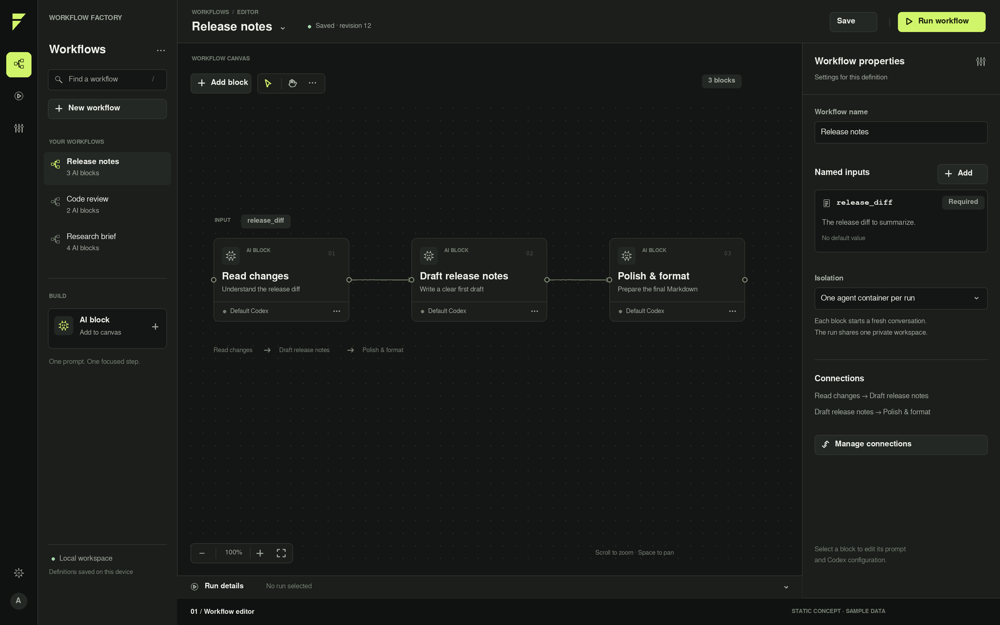
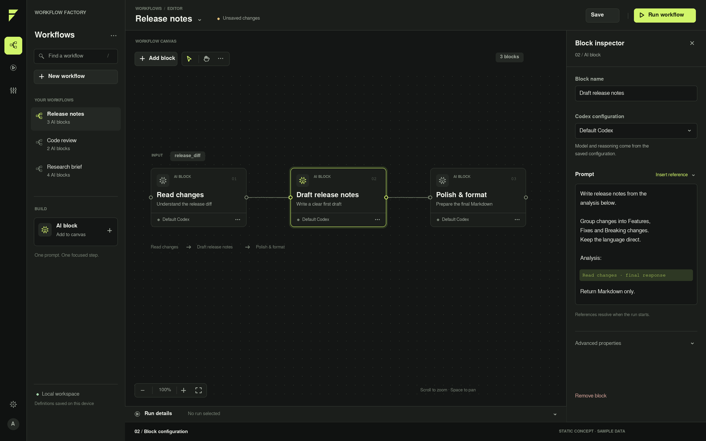
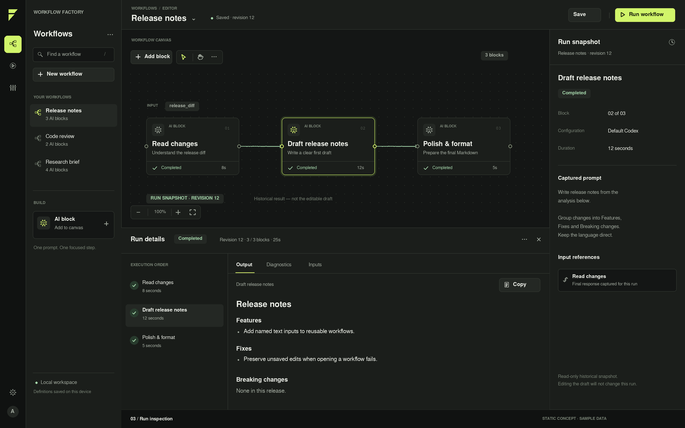

# Canvas-first design references

These three original static concepts define one shared design direction. All data is illustrative; they are not application screenshots or execution evidence. The [behavior spec](../../specs/canvas-first-redesign.md) and [DESIGN.md](../../../DESIGN.md) clarify behavior and correct accessibility/data limitations without changing the composition.

1. **Workflow editor:** central sequential graph, workflow browser, workflow-properties inspector and collapsed run strip.
   
2. **Block configuration:** same canvas with selected block, configuration field, prompt and reference insertion.
   
3. **Run inspection:** explicitly read-only historical graph, captured block inspector, ordered block list and expanded output drawer.
   

The PNGs remain byte-identical to those supplied in the design discussion. Verify with `sha256sum -c SHA256SUMS` from this directory. Each is 1920 × 1200 pixels. The concept footer, sample workflows/results/revisions/durations, temporary avatar/mark and pictured rich reference chip are not production requirements; see the specs for their treatment.

The design tokens are normative in DESIGN.md. `theme.css` is a generated Tailwind v4 token export; `tokens.json` is a generated W3C DTCG export. They are documentation artifacts and are not imported by the app. Derived exports are regenerated when DESIGN.md changes.
